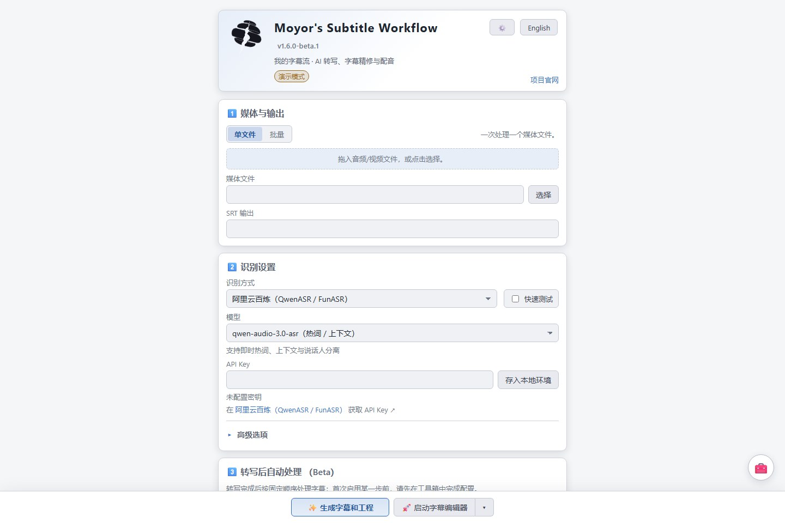

# 安装与升级

从 [MSW Releases](https://github.com/xiaoyaomoyor/moyors-subtitle-workflow/releases) 下载已正式发布的安装包。本分支正在准备 1.7.0，以下为候选包命名；正式附件以 Release 页面为准。

| 文件 | 系统 | 内置 FFmpeg |
| --- | --- | --- |
| `MSW-Windows-x64-v1.7.0.zip` | Windows x64 | 是 |
| `MSW-lite-Windows-x64-v1.7.0.zip` | Windows x64 | 否 |
| `MSW-macOS-arm64-v1.7.0.zip` | macOS Apple Silicon | 是 |
| `MSW-lite-macOS-arm64-v1.7.0.zip` | macOS Apple Silicon | 否 |
| `MSW-Linux-x86_64-v1.7.0.AppImage` | Linux x86_64 | 是 |

GitHub 另提供 **Source code (zip)** 和 **Source code (tar.gz)**，包含标签对应的源码，不是可直接启动的应用包。macOS Intel、Windows ARM64、Linux ARM64 暂无本轮官方构建产物。

## 启动

- Windows：完整解压 ZIP，进入目录运行 `MSW.exe`。不要从压缩软件中直接运行，也不要只复制 EXE；`_internal` 与旁边的资源目录必须保留。下载标记造成 DLL 加载失败时见[FAQ](FAQ.md)。
- macOS：解压后打开 `MSW.app` 或 `MSW-lite.app`。当前流程进行 ad-hoc 签名，不包含 Apple 公证；只在确认下载来源后按系统提示允许打开，不建议关闭系统整体安全保护。
- Linux：对下载的 AppImage 执行 `chmod +x MSW-Linux-x86_64-v1.7.0.AppImage`，再运行它。目标为 x86_64 图形桌面，构建基于 Ubuntu 22.04；若系统不支持 FUSE，可尝试 `./MSW-Linux-x86_64-v1.7.0.AppImage --appimage-extract-and-run`。

标准版包含媒体处理用的 `ffmpeg` / `ffprobe`；lite 需要配置现有 FFmpeg。两者都不自带云端额度或 API Key，也不捆绑大型 ASR / TTS 模型。普通用户无需安装开发用的 Python、Node、Rust 或 npm。

通过 Launcher 或 `--editor` 打开的是本机 Server 编辑器，地址为 `127.0.0.1`。翻译、TTS、素材收集和媒体导出依赖这个本机服务；独立便携 HTML 已停止分发与维护，普通使用请通过启动器打开本机编辑器。

## 首次配置

1. 直接启动编辑器并导入视频即可使用；需要 ASR 时，在编辑器「编辑 → 编辑器设置 → 服务与环境」或启动器配置对应服务。
2. 在编辑器「编辑 → 编辑器设置 → 服务与环境」设置 LLM 和 TTS；本机 IndexTTS 需先启动它自己的服务，油库里可在此安装独立资源。
3. 打开媒体或字幕，编辑、翻译、配音；生成音频进入素材库，可拖入波形显示器。
4. 保存为 `.mosp` 工程，再按需导出字幕、音频、视频或剪辑工程。完整功能与依赖见[环境清单](ENVIRONMENT.md)。

## 1.6.x／1.7.x 工程与配置

字幕使用 v4 平级轨道模型，兼容读取旧工程；首次保存升级时备份旧文件，升级后的工程需用新版继续编辑。波形缓存位于媒体的 `_msw` 目录，有效 `.quapeaks` 优先，缺失可重建。

「编辑器设置」管理个人偏好、服务与配置导入导出；「项目设置」管理轨道、说话人及项目规则。独立 `.mswconfig` 不包含密钥或工程字幕。主题与布局等个人偏好由本机服务统一保存，换端口或浏览器仍可使用。

保存备份和恢复记录可用于找回误操作前的版本；迁移工程时仍须保留原媒体及音频素材。

## 升级与迁移

- 先保存工程，备份 `.mosp`、同目录 `.assets` 素材文件夹和原媒体；不要只复制工程文件。
- 退出旧版，新版解压到新目录试用，保留旧版便于回退。不要覆盖正在运行的应用或直接删除用户数据目录。
- 云端 Key、连接与本机资源配置不写入工程。若旧版本在程序目录读取 `.env`，可由用户自行迁移该文件或重新填写配置；不要把它发到 GitHub。
- 本机任务、恢复历史不随工程自动迁移；个人设置可通过配置管理导出和导入。
- `.mosp` 和旧 `.json` 工程继续兼容；上游 MAW 不保证理解 MSW 的配音扩展，交给其他工具前保留原工程并导出相应格式。

本版本仅在其验证记录列出的平台与条件下确认。源码测试通过不能替代对每个平台实际安装包的启动检查，发布状态见[构建与发布](RELEASING.md)。
